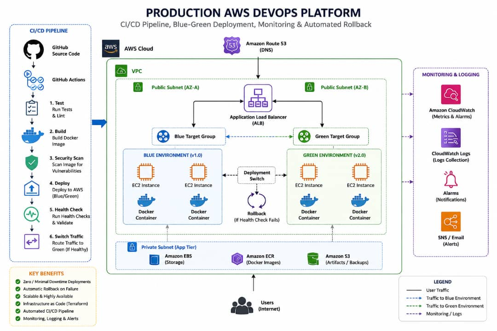

# Production AWS DevOps Platform

A production-style DevOps project demonstrating Infrastructure as Code, containerization, automated CI/CD, blue-green deployments, health checks, rollback, and AWS-native monitoring.

The platform provisions AWS infrastructure with Terraform, packages an Nginx-based application in Docker, builds and scans images through GitHub Actions, stores images in Amazon ECR, and deploys to EC2 instances using AWS Systems Manager (SSM). An Application Load Balancer (ALB) routes production traffic between blue and green target groups.

> **Project status:** The documented implementation includes Terraform-managed AWS infrastructure, Docker, GitHub Actions CI/CD, ECR, GitHub OIDC, SSM-based deployment, ALB blue-green traffic switching, rollback handling, a CloudWatch dashboard, six CloudWatch alarms, and SNS email notifications.

## Architecture



See [Architecture Guide](docs/ARCHITECTURE.md) for the component breakdown and traffic flow.

---

## Project goals

- Provision AWS infrastructure using Terraform.
- Containerize the application with Docker.
- Build and scan application images in GitHub Actions.
- Publish approved images to Amazon ECR.
- Authenticate GitHub Actions to AWS using OIDC rather than long-lived AWS access keys.
- Deploy to EC2 through AWS Systems Manager Run Command.
- Implement blue-green deployments using an Application Load Balancer and two target groups.
- Validate target health before shifting production traffic.
- Restore the previous application image or listener routing when deployment validation or promotion fails.
- Monitor target health, EC2 CPU, and HTTP 5xx metrics with CloudWatch.
- Send alarm notifications through Amazon SNS email subscriptions.

---

## Technology stack

| Area | Technologies |
|---|---|
| Cloud | AWS |
| Infrastructure as Code | Terraform |
| Containerization | Docker |
| Web server / sample application | Nginx |
| Source control | Git, GitHub |
| CI/CD | GitHub Actions |
| Image registry | Amazon Elastic Container Registry (ECR) |
| Deployment management | AWS Systems Manager (SSM) |
| Traffic management | Application Load Balancer (ALB), target groups |
| Monitoring | Amazon CloudWatch |
| Notifications | Amazon SNS |
| Security integration | GitHub OIDC, IAM roles, Trivy image scanning |
| Operating system / shell | Linux, Bash |

---

## How the deployment works

1. A developer pushes a change to the configured branch.
2. GitHub Actions builds a Docker image tagged with the Git commit SHA.
3. Trivy scans the image for configured vulnerabilities. The pipeline fails when findings meet the configured severity and exit-code policy.
4. The approved image is published to ECR.
5. The CD workflow obtains temporary AWS credentials through GitHub OIDC.
6. The workflow identifies the active and inactive target groups from the ALB listener configuration.
7. Both target groups remain associated with the listener, with the active group receiving production traffic and the inactive group initially receiving zero weight.
8. SSM runs the deployment commands on the inactive EC2 instance.
9. The workflow waits for the new target to become healthy in its ALB target group.
10. If validation succeeds, listener weights are changed so the newly deployed target group receives production traffic.
11. If deployment validation or listener promotion fails, the workflow attempts to restore the previous container image and/or listener weights.

Read [CI/CD Guide](docs/CI-CD-GUIDE.md) and [Blue-Green Deployment Guide](docs/BLUE-GREEN-DEPLOYMENT.md) for details.

---

## Repository documentation

| Document | Description |
|---|---|
| [Architecture](docs/ARCHITECTURE.md) | AWS components, relationships, and request flow |
| [Implementation Guide](docs/IMPLEMENTATION-GUIDE.md) | End-to-end setup and implementation sequence |
| [Terraform Guide](docs/TERRAFORM-GUIDE.md) | Terraform concepts, resource responsibilities, and commands |
| [CI/CD Guide](docs/CI-CD-GUIDE.md) | CI, image scanning, ECR publishing, OIDC, and SSM deployment |
| [Blue-Green Deployment](docs/BLUE-GREEN-DEPLOYMENT.md) | Target groups, traffic switching, health validation, and rollback |
| [Monitoring Guide](docs/MONITORING-GUIDE.md) | Dashboard, six alarms, SNS, and notification testing |
| [Troubleshooting](docs/TROUBLESHOOTING.md) | Common failures, diagnostic commands, and fixes |

---

## Prerequisites

Before reproducing the project, prepare:

- An AWS account and an IAM identity permitted to create the resources used by the Terraform configuration.
- AWS CLI v2 configured for the intended account and region.
- Terraform version compatible with the repository's Terraform configuration (the project configuration has used Terraform `>= 1.5`).
- Docker Engine.
- Git and a GitHub account.
- A GitHub repository containing the application, Terraform configuration, and workflow files.
- An email address that can receive and confirm SNS subscription messages.

Use the exact versions and providers declared in the repository's Terraform files and lock file. Do not commit credentials, Terraform state, `.env` files, or private keys.

---

## Quick start

The commands below are a general starting sequence. Run them from the relevant project directories and check the repository's actual file names before applying them.

```bash
git clone https://github.com/cyberar/production-aws-devops-platform.git
cd production-aws-devops-platform

aws sts get-caller-identity
aws configure get region

terraform -chdir=terraform init
terraform -chdir=terraform validate
terraform -chdir=terraform plan
```

Review the plan carefully before applying infrastructure:

```bash
terraform -chdir=terraform apply
```

After provisioning, configure the GitHub repository/environment variables and IAM OIDC trust relationship as documented in [Implementation Guide](docs/IMPLEMENTATION-GUIDE.md) and [CI/CD Guide](docs/CI-CD-GUIDE.md).

---

## Configuration and sensitive values

The workflow uses repository or GitHub Environment variables for non-secret configuration such as AWS region, account ID, ECR repository name, role ARN, ALB ARN, target-group ARNs, and EC2 instance identifiers. The CD workflow's `environment:` setting determines which GitHub Environment supplies those variables.

Use GitHub's environment/repository variable and secret mechanisms as appropriate. Never put AWS access keys, passwords, private keys, or other credentials in source files. The intended AWS authentication approach is GitHub OIDC with a role that grants only the actions required by the workflows.

---

## Monitoring currently implemented

The CloudWatch dashboard is named `production-devops-platform`. The current alarm set contains:

- `production-blue-unhealthy-targets`
- `production-green-unhealthy-targets`
- `production-blue-high-cpu`
- `production-green-high-cpu`
- `production-alb-5xx-errors`
- `production-app-5xx-errors`

Alarm notifications are delivered through the SNS topic `production-devops-alerts`. The email subscription must be confirmed before notifications can be delivered.

See [Monitoring Guide](docs/MONITORING-GUIDE.md).

---

## Validation checklist

- [ ] Terraform initializes, validates, and produces a reviewed plan.
- [ ] Infrastructure resources are provisioned in the intended AWS region.
- [ ] Both target groups are associated with the ALB.
- [ ] The currently active target group is healthy.
- [ ] The inactive target group can receive a deployment and become healthy.
- [ ] CI builds and scans the image.
- [ ] An approved image is pushed to ECR with its commit SHA tag.
- [ ] CD authenticates through OIDC and deploys through SSM.
- [ ] Traffic switches only after ALB health validation succeeds.
- [ ] Rollback behavior has been tested in a controlled environment.
- [ ] CloudWatch dashboard and six alarms exist.
- [ ] SNS email subscription is confirmed and a test notification is received.

---

## Scope and future work

This repository documents the monitoring already implemented. Additional work such as CloudTrail audit configuration, centralized EC2 log collection, expanded security hardening, and more advanced observability is intentionally reserved for a separate project.

---

## Cost and cleanup

AWS resources can incur charges while they exist, including EC2 instances, ALB hours and capacity units, ECR storage, CloudWatch metrics/alarms/dashboards, and data transfer. Review current AWS pricing for your region and monitor billing.

Do not destroy infrastructure until you have confirmed that no workload or data needs it. Run:

```bash
terraform -chdir=terraform plan -destroy
terraform -chdir=terraform destroy
```

CloudWatch dashboards, alarms, SNS topics/subscriptions, and resources created outside Terraform may need separate cleanup. 
