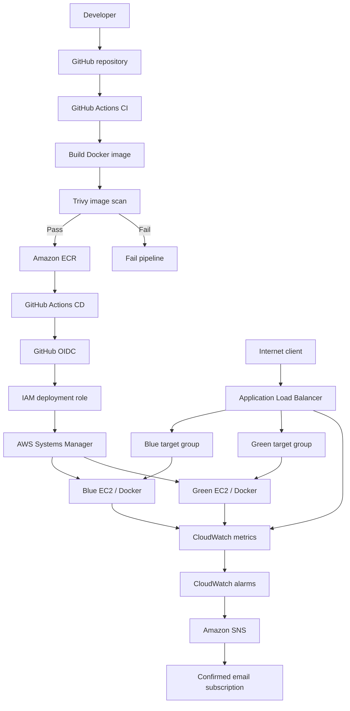

# Architecture Guide

## 1. Overview

The platform uses an AWS Application Load Balancer in front of two EC2 deployment environments: blue and green. Each environment is registered in its own target group. The ALB listener forwards requests according to target-group weights.

Terraform provisions the cloud infrastructure. Docker packages the web application. GitHub Actions performs continuous integration and deployment. Amazon ECR stores versioned images. GitHub Actions assumes an AWS IAM role through OIDC and invokes AWS Systems Manager Run Command to deploy to EC2 without requiring the workflow to open an SSH connection.

## 2. Logical architecture

The diagram is logical: exact subnet, route-table, NAT, and security-group relationships must be read from the current Terraform configuration and the architecture image in this repository.

## 3. Main components

### Amazon VPC and networking

The Terraform configuration creates the network boundary for the application. It includes a VPC and public subnets across Availability Zones for the load balancer and EC2 deployment instances, along with the associated routing and security-group configuration. Confirm exact CIDRs, subnet count, and route-table associations in the `.tf` files before changing the network.

### Application Load Balancer

The ALB is the public entry point for HTTP application traffic. Its listener uses a forward action with weighted target groups. During a normal deployment, the active group receives weight 100 and the inactive group receives weight 0. Both groups remain associated with the listener so that the inactive target can be health-checked before promotion.

### Blue and green EC2 instances

Each EC2 instance runs the application container. The deployment workflow targets the inactive instance, so the currently serving environment can continue handling production traffic while the replacement is deployed and validated.

### Target groups

`production-blue-tg` and `production-green-tg` register the corresponding EC2 instances on port 80. The ALB health check evaluates the configured path (the project has used `/`) and expects HTTP 200. A target must be healthy before the workflow shifts traffic to it.

### Docker and Nginx

The sample application is served by Nginx inside a Docker container. The container listens on port 8080, while the EC2 host exposes port 80 to the ALB through the deployment's port mapping (`80:8080`). This distinction is important: the target group connects to EC2 port 80, not directly to container port 8080.

### Amazon ECR

ECR stores built container images. The workflow tags images with the Git commit SHA so a deployment can refer to a specific immutable version rather than a moving `latest` tag.

### GitHub Actions, OIDC, and SSM

GitHub Actions runs the CI and CD workflows. OIDC provides short-lived AWS credentials by allowing the workflow to assume a designated IAM role. SSM Run Command executes deployment commands on the EC2 instance. The EC2 instance role must also permit the instance to communicate with SSM and pull its image from ECR.

### CloudWatch and SNS

CloudWatch receives ALB and EC2 metrics, displays them on the `production-devops-platform` dashboard, and evaluates six alarms. Alarm actions publish to the `production-devops-alerts` SNS topic, which sends email to a confirmed subscription.

## 4. Request flow

1. A client sends an HTTP request to the ALB DNS name.
2. The ALB listener evaluates its forward action.
3. The listener sends the request to the target group with the active weight.
4. The target group forwards the request to the EC2 host on port 80.
5. Docker publishes host port 80 to container port 8080.
6. Nginx serves the application response.

## 5. Deployment flow

1. CI builds and scans a commit-specific image.
2. The image is pushed to ECR only after the configured scan succeeds.
3. CD assumes the AWS deployment role through OIDC.
4. CD reads listener weights to identify active and inactive target groups.
5. Both target groups are associated with the listener at active 100 / inactive 0.
6. SSM deploys the new image to the inactive EC2 instance.
7. CD waits for the inactive target to pass ALB health checks.
8. CD promotes the new target group by changing listener weights.
9. If validation or promotion fails, the workflow attempts to restore the previous image and/or listener weights.

## 6. Trust boundaries

- GitHub Actions obtains AWS access through an IAM role trust policy, not embedded long-lived credentials.
- The EC2 instance role is separate from the GitHub deployment role.
- The ALB security group should be the source allowed to reach the application host port.
- The ALB target group and container port mappings must agree.
- SNS email subscriptions require confirmation by the recipient.

**Note**: Review the actual security-group and IAM policy files before assuming a permission or network path exists.
